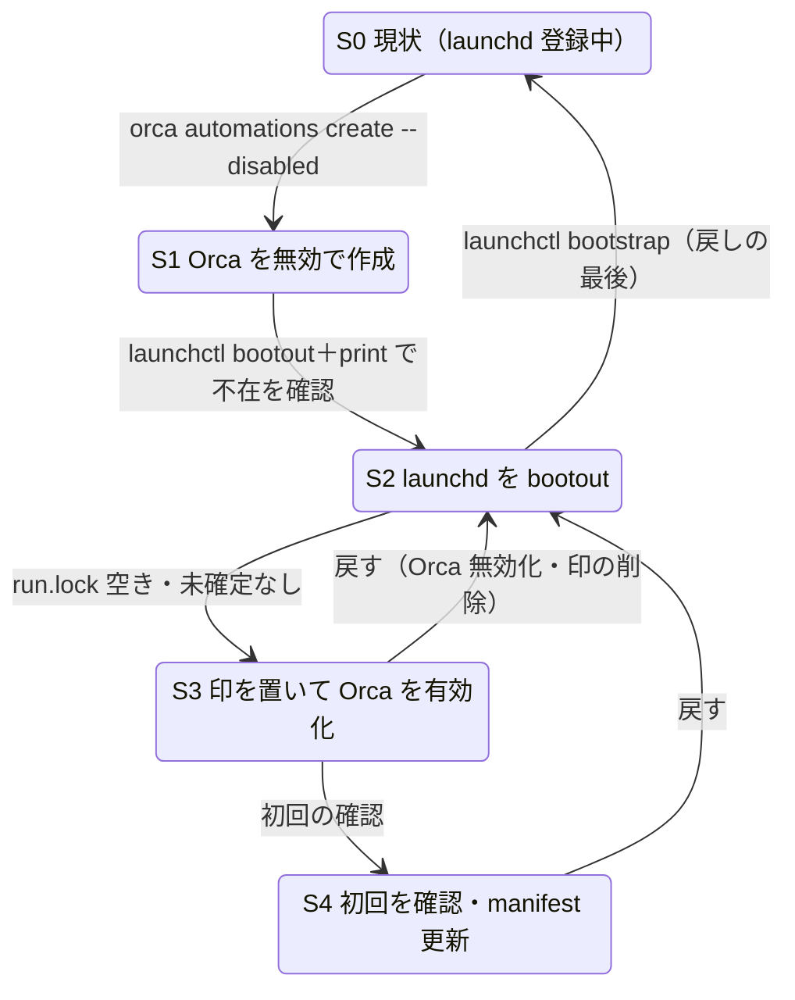

# 定期処理を別の実行器へ引き継ぐ

tokyo-date-spots の定期処理を、いまの実行器（launchd）から Orca へ、二重に動かさずに移すための手順。Orca の後に Codex・Claude・t3code など別の実行器へ移すときも同じ手順を使う。依頼は本人の 2026-11-24 の指示「のこりもorcaにうつそう」（受付は bot sakimytocom）。形は sakimyto/sakimytocom の `docs/automation-handoff.md` と sakimyto/sakimemo の PR #642 にそろえた。

この文書と [ops/automation/manifest.json](../ops/automation/manifest.json) を作った時点では、どの登録も止めていない・変えていない・新しく作っていない。処理の手動実行もしていない。観測は 2026-11-24 08:05 JST ごろのもので、登録の稼働を保証する値ではない。

## 正本と実行用コピー

- 一覧の正本は [manifest](../ops/automation/manifest.json)。目的・時刻・いまの実行器と状態・入力・出力・状態の置き場所・重複防止・停止条件・人の判断点・引き継ぎ状況を持つ。
- 指示の入口は [ops/automation/odekake-weekly.prompt.md](../ops/automation/odekake-weekly.prompt.md)。中身はスクリプトなので、入口は「launchd と同じ環境で実行コピーを1回呼び、終わりを待って報告する」だけの薄いものにした。
- 実行の契約は [.loop/weekly.md](../.loop/weekly.md)、導入・停止・再開は [automation/README.md](../automation/README.md)、公開は [PUBLISH.md](../PUBLISH.md)。これらを複製しない。
- `desiredStatus` は期待する状態、`observedStatus` は `observedAt` 時点の観測である。登録を変えたら、同じ変更で manifest を直す。
- sakimemo の全PJ台帳では AL-366（移管先 launchd）、AL-146（移管元 Grok 9-05-bot）、DUP-47。この repo には依頼台帳がない。台帳の更新は受付担当が行う。

## 一覧（2026-11-24 の観測）

| id | 時刻（JST） | いまの実行器 | 状態 | 引き継ぎ |
| --- | --- | --- | --- | --- |
| odekake-weekly | 金曜 09:05 | launchd `com.sakimyto.tokyo-date-spots-weekly` | 11/20 の初回が implement で停止。照合待ち | Orca へ（未着手。11/20 の照合後） |

ほかに時刻で動く処理はない。確かめた範囲:

- GitHub Actions: `.github/workflows/automation-checks.yml` だけで、`pull_request` と main への `push` で起動する。`schedule` はない。
- launchd: `~/Library/LaunchAgents` で該当するのは上の1件だけ。crontab に該当なし。
- Codex の automation（`~/.codex/automations/*/automation.toml`）と Orca の登録（`orca automations list`）に、tokyo-date-spots・odekake を含むものはない。
- 旧 Grok routine 9-05-bot（AL-146）は、2026-11-13 11:48 JST に親担当が一時停止したという依頼元報告だけがある。この Mac から実設定は読めない（未確認）。

## 失敗の原因（2026-11-20 09:05 の回）

**原因: Codex の利用上限。** 実装の工程で呼んだ `codex exec` が、turn を始める前に `usage_limit_exceeded` で終わった。コードや認証の不具合ではない。

根拠:

1. `state.json` の `runs["2026-11-20"]` は `needs-reconciliation`・phase `implement`・`collection: {accepted: 34, removals: 29}`。収集（Claude Opus 5.5）と機械検査（有効追加34件、30件以上）は通っている。
2. 共有 runner の receipt（`~/_pjsc/_work/date-spots-weekly-20261120/tokyo-weekly-2026-11-20-implement-1/result.json`）は `exit_code: 1`、09:17:08〜09:17:13 の5秒、`changed_files: []`。
3. 同じ session_id の Codex の会話記録（`~/.codex/sessions/2026/11/20/rollout-2026-11-20T09-17-10-01a1f650-71d9-76b0-84d1-ad495c892920.jsonl`）の `task_complete` が `error.codex_error_info: usage_limit_exceeded`、limit は `premium`、モデル `gpt-6.2-sol`、解除予定 2026-11-23 13:42。
4. `weekly.py` は子 CLI の失敗をすべて「CLI exit=1。認証・検査・権限の確認が必要」と書くので、RESULT.md と state には理由が残らなかった。runner の `run.log` は工程の終わりに消える。

**回復: 確認済み（新しい観測）。** 2026-11-23 17:22 JST から 2026-11-24 07:58 JST まで、同じ `gpt-6.2-sol` の Codex の会話（新しい順に確かめた9件）がエラーなしで `task_complete` に達した。11-24 07:56 の会話の `rate_limits` は `codex` の週の枠で3%。予定時刻が過ぎたことではなく、この実行の記録で回復を判断した。本人の操作は要らない。

**副作用: なし。** 実装の工程は何も書いていない。push・PR・公開は起きていない。当週の worktree `~/_pjsc/_wt/tokyo-date-spots-weekly-20261120` はすでに無い（誰が外したかは未確認）。branch `sakimyto/weekly-20261120` はローカルに残っており、commit は origin/main（fcce7e1）と同じで、独自の commit はない。リモートには push されていない。

### 11/20 の回の扱い（本人の判断）

**適用済み（2026-11-24 08:41 JST）**: 本人が A（見送る、次回 11/27 から通常どおり）を選んだ（Orca item 36）。`run.lock` の flock を取って、`runs["2026-11-20"]` を `abandoned["2026-11-20"]`（`abandoned_at`・`abandoned_reason` つき）へ移した。読み戻しで未確定の行は0件になった。state のコピーで 11/27 の `tick` が未確定の週の検査を通り、worktree の準備へ進むことも確かめた。launchd の登録・処理の実行・RESULT.md には触れていない。

以下は決定前の記録。決める前は、**11/27（金）09:05 の回が「未完了の週がある」で exit 1 になる**状態だった。外部への影響はない（state も RESULT.md も書き換えずに止まる）。それまでに次のどちらかを決める。

| 案 | すること | 注意 |
| --- | --- | --- |
| A 見送る（推奨） | 11/20 の収集は1週前のもので、会期の短い催しは終わっている。11/20 は適用しないと決め、11/27 から新しく始める | いまの `weekly.py` には「見送り」の状態がない。`published`・`no-change` と偽って書かない。親担当が、実行中が無いことを確かめてから `state.json` の `runs["2026-11-20"]` を取り除き、同じ内容に理由と日時を足して最上位の `abandoned["2026-11-20"]` へ移す（`weekly.py` と `install.py` は `runs` だけを見るので、`abandoned` は記録として残る）。改修案1を入れた後なら、そのコマンドを使う |
| B 再開する | 親担当が `git -C ~/_pjsc/tokyo-date-spots worktree add ~/_pjsc/_wt/tokyo-date-spots-weekly-20261120 sakimyto/weekly-20261120`（`-b` なし）で残っている branch に worktree を付け直し、`weekly.py --resume 2026-11-20` を実行する | worktree を付け直さずに再開すると、`prepare_worktree` の `git worktree add -b` が exit 255 で止まる（下の再現）。branch は消さない。1週前の収集をそのまま公開することになる |

再現（2026-11-24、スクラッチの使い捨て repo と state のコピー。本物の state・repo には触れていない）:

- B: branch だけがある状態で `prepare_worktree(..., 2026-11-20)` を呼ぶと「CLI exit=255。認証・検査・権限の確認が必要」で止まる。branch を消した対照では worktree を作れる。`-b` なしで worktree を付け直した後は、既存の worktree として通る。
- A: 11/20 の行が `runs` にある state で 11/27 の `tick` を呼ぶと「未完了の週がある」で止まる。行を `abandoned` へ移した後は、その検査を通って worktree の準備まで進む。

### 改修案（この PR では入れない）

`weekly.py` の状態遷移は公開の可否を決める部分で、repo を直しても `install.py` で再配置するまで実行コピーに届かない。そのため、ここでは案だけを書く。入れるときは別の PR で、TDD と実行コピーの再配置の手順（README の「再配置」）に従う。

1. **見送りの状態を足す。** `--abandon YYYY-MM-DD --reason <text>` で、未確定の行を `abandoned`（公開なし・理由と日時つき）にする。`abandoned` は `published`・`no-change` と同じく「確定済み」として扱い、公開の工程で止まった行（phase `publish`）は拒む。
2. **branch が残っているときの再開。** worktree が無く、branch が origin/main の祖先で独自の commit が無いときだけ、`git worktree add <path> <branch>` で付け直す。独自の commit があれば今までどおり止める。
3. **失敗の理由を残す。** 子 CLI の失敗をまとめて「CLI exit=N」にせず、git の失敗と AI CLI の失敗を分ける。共有 runner の `run.log` を消す前に `usage_limit_exceeded` などの既知のエラーコードだけを拾って state の reason に入れる（ログ本文は残さない）。

## 状態遷移と禁止状態

旧（launchd）と新（Orca）の組で状態を表す。新は「登録が有効か」と「有効化の印があるか」の2つの錠を持ち、両方そろったときだけ予定の時刻に本体を動かす。

| 状態 | 旧（launchd） | 新の登録 | 有効化の印 | 次へ進む条件 |
| --- | --- | --- | --- | --- |
| S0 現状 | 登録中 | なし | なし | 新を無効のまま作る |
| S1 新を無効で用意 | 登録中 | 無効 | なし | 旧を bootout し、見つからないことを読み戻す |
| S2 旧を停止 | 停止（plist は残す） | 無効 | なし | `run.lock` を生きたプロセスが持っていない・state に未確定の行がない |
| S3 新を有効化 | 停止 | 有効 | あり | 新の初回が想定どおりに終わった |
| S4 引き継ぎ完了 | 停止 | 有効 | あり | manifest の `runner` を新にした |



- **禁止状態は「旧と新が同じ期間に両方動く」こと。** 旧が登録中の間（S0・S1）は、新の本体を動かす操作をすべて禁じる。
- **S0〜S2 では Orca の手動実行（Run now、`orca automations run <id>`）を使わない。** 手動実行は precheck を迂回する（`orca automations create --help` の Notes）。
- 状態ファイルは旧と新で同じもの（`~/.codex/automation-state/tokyo-date-spots-weekly/`）を使う。新しい state を作らず、初期化もしない。
- **二重の守り。** 入口の手順1は、launchd の登録が残っていれば実行しない。さらに旧と新が同じ実行コピーを呼ぶので、`run.lock` の flock で同時の2つ目は何もせず終わり、`state.json` の日付の行で同じ週の2回目は `duplicate` か未確定の検査で止まる。

### 有効化の印（precheck）

`--precheck` には、印のファイルが**ある**ときだけ0を返すコマンドを絶対パスで入れる。

```sh
test -f /Users/sakimyto/_pjsc/_work/orca-automation-enable/odekake-weekly.enabled
```

印が無い・パスを誤った・作業フォルダの片付けで消えた、のどれでも本体は動かない。印を置くことを S3 への遷移そのものにする。印のパスは manifest の `runner.enableMarker` に書き足す。

## 1件ずつの引き継ぎ手順

### 移す前に満たす条件

1. 11/20 の回を決め、`state.json` に未確定の行がない（上の「11/20 の回の扱い」）。
2. launchd で少なくとも1回、自動の回が最後まで終わっている（`published` か `no-change`）。この処理はまだ自動で成功したことがないので、実行器の問題と処理の問題を分けるため。
3. sakimytocom の weekly-search-growth・security-knowledge-weekly の Orca への引き継ぎが終わっている（外部へ公開する処理を最後に回す。sakimytocom の引き継ぎ順でも odekake-weekly は最後）。
4. 入口の `env -i` は、plist の3つの変数（PATH・TMPDIR・TZ）と HOME・USER・LOGNAME だけを渡す。launchd が自動で与える変数と完全に同じかは確かめていない。そのため S3 の前に、同じ `env -i` で読み取りだけのコマンドを確かめる: `git -C ~/_pjsc/tokyo-date-spots ls-remote origin HEAD`、`git -C ~/_pjsc/sakimytocom ls-remote origin HEAD`、`gh auth status`、`claude --version`、`codex --version`。両 repo の origin は HTTPS（2026-11-24 確認）なので SSH agent は要らない。push の認証は公開の工程で初めて使われ、そこでの失敗は再開できないので、この確認を省かない。
5. Orca の会話が、切り離して起動したプロセスを最大約4時間15分見届けられることを確かめた（会話の終わりや timeout で子プロセスが kill されない）。odekake とは無関係な、`sleep` だけをする使い捨ての登録で試せる。確かめられなければ launchd に残す。

S3 に入った直後（旧は止まっている）の金曜以外の日に、`orca automations run <id>` で入口を1回動かしてよい。`weekly.py` は金曜以外の日には何もせず exit 0 になるので、入口の手順1〜6（launchd 不在の判定、state の読み取り、hash の比較、`env -i` での起動、終わりの確認、報告）が通るかを確かめられる。`env -i` で会話の環境変数（`CURUMI_CODEX_DELEGATION_DEPTH`・Claude Code のセッション変数など）を渡さないことも、ここで `orca.err.log` が空であることから確かめる。

### 切替PRで直す記述

S3 の前に、次の記述を Orca 前提に直す PR を出す（merge は S2 の後）。いまは launchd を前提に書かれている。

- `.loop/weekly.md`: 「金曜09:05 JSTにMacのlaunchdが1回起動する」「アプリ定期タスク…は使わない」。
- `.loop/INDEX.md` の runtime の列（Mac launchd）。
- `automation/README.md`: 冒頭の Label・plist の説明、「停止と再開」の bootout の手順。
- `AGENTS.md`: 「Macの定期処理は…」の1文。
- `ops/automation/manifest.json` の `runner`（S4 で current を orca に）。

### 1. 新を無効のまま作る（S0→S1）

```sh
mkdir -p /Users/sakimyto/_pjsc/_work/orca-automation-enable
orca automations create --name "tokyo-date-spots｜金曜09:05｜おでかけ週次更新" \
  --trigger "5 9 * * 5" --timezone Asia/Tokyo --disabled \
  --provider claude --workspace path:/Users/sakimyto/_pjsc/tokyo-date-spots \
  --precheck "test -f /Users/sakimyto/_pjsc/_work/orca-automation-enable/odekake-weekly.enabled" \
  --missed-run-grace-minutes 1 \
  --prompt "origin/main の ops/automation/odekake-weekly.prompt.md を読み、その指示に従って実行する"
orca automations show <id>
```

- `show` で `enabled: false`・trigger `5 9 * * 5`・timezone `Asia/Tokyo`・precheck を読み戻す。読み戻せなければ `orca automations remove <id>` で消し、引き継ぎを止める。
- `--missed-run-grace-minutes` は sakimytocom で 0 を拒否され 1 にした。無効の間に過ぎた予定を取り戻す動きは未確認なので、小さい値にする。
- `--workspace` の指定形式（`path:`）は sakimytocom の実例で確かめる。主 checkout は読み取りにだけ使う（入口は repo へ書き込まない）。
- この手順は `orca automations create --help`（2026-11-24）で確かめた範囲で、作成は試していない。

### 2. 旧を止める（S1→S2）

金曜の回が終わった後、次の木曜までに行う。

1. `$S/run.lock` を生きたプロセスが持っていないことを確かめる（ファイルは常にあるので有無では判断しない）。例: `lsof "$S/run.lock"` が空。
2. `launchctl bootout gui/$(id -u)/com.sakimyto.tokyo-date-spots-weekly`。plist・state・worktree・branch は残す。
3. `launchctl print gui/$(id -u)/com.sakimyto.tokyo-date-spots-weekly` が「見つからない」で失敗することを読み戻す。

`$S/STOP` は使わない。STOP は新の入口も止めるので、置いたまま有効化すると新の初回が何もしない。STOP は README どおり再配置のときだけ使う。

### 3. 止まったことを確かめる（S2 の確認）

- 上の読み戻しに加え、`state.json` に `published`・`no-change` 以外の行が無いこと。
- `ps` に `weekly.py`・`delegate-task.mjs`・`claude --print` の該当プロセスが無いこと。
- 残っていれば、新を有効にする前に照合する。結果が分からない push・PR・merge・公開は、PR・CI・公開版と照合し、再送しない。

### 4. 新を有効にする（S2→S3）

1. `touch /Users/sakimyto/_pjsc/_work/orca-automation-enable/odekake-weekly.enabled`
2. `orca automations edit <id> --enabled`、`orca automations show <id>` で `enabled: true` を読み戻す。
3. manifest の `runner.enableMarker` に印のパスを書く。

### 5. 初回を確かめる（S3→S4）

新の初回の金曜 09:05 の後に、次をすべて確かめる。これが「同じ枠が二重に出ていない」ことの確認になる。

| 確かめること | 方法 | 期待 |
| --- | --- | --- |
| 旧が動いていない | `launchctl print gui/$(id -u)/com.sakimyto.tokyo-date-spots-weekly` | 見つからない |
| 新が1回だけ動いた | `orca automations runs --id <id>` | 当日の実行が1件（`skipped_precheck` でない） |
| 状態が1回分だけ進んだ | `state.json` の `runs["YYYY-MM-DD"]` | 行が1つ、`attempts` が 1、status が `published` か `no-change` |
| 公開が1回だけ | 東京は `gh pr list -R sakimyto/tokyo-date-spots --state all --head sakimyto/weekly-YYYYMMDD`。サイトは branch 名が工程の中で決まるので、`state.json` の `receipt.site_pr` と、`gh pr list -R sakimyto/sakimytocom --state all --search "created:YYYY-MM-DD"` の当日の PR を突き合わせる | 各 repo に当週の PR が1つで、receipt の PR と同じ |
| 公開内容が一致 | `state.json` の `verified_rows` と RESULT.md | 公開 JSON・サイト API との全行一致の記録がある |

`attempts` が2以上、PR が2つ以上、旧と新の両方に実行記録がある、のどれかなら二重実行として扱い、戻し方の手順に入る。確かめるまで launchd の plist は消さない。最後に manifest の `runner.current` を `orca` に、`handoff.status` を `done` にする（`done` は本人が完了と言ってから）。

### 6. 戻し方（S3・S4→S2→旧を再開）

1. 新を止める: `orca automations edit <id> --disabled` を読み戻し、印のファイルを消す。
2. 新の実行中の回が終わるのを待つ（`run.lock` を生きたプロセスが持っていない・`orca automations runs` に実行中が無い）。
3. `state.json` に未確定の行が無いことを確かめる。あれば照合してから進む。
4. 旧を再開する: `launchctl bootstrap gui/$(id -u) ~/Library/LaunchAgents/com.sakimyto.tokyo-date-spots-weekly.plist`、`launchctl print` で読み戻す。`install.py --load` は STOP と再配置の検査があるので、戻しには使わない。
5. manifest の `runner` を launchd に戻す。

### 禁止状態に入らないことの確かめ方

`tests/test_automation_manifest.py` の `HandoffStateMachine` が、上の手順と戻し方を状態機械でたどる。状態は旧の登録・旧の実行中の回・新の登録・有効化の印・新の実行中の回の5つの真偽と手順の位置で、到達できる状態を全部数え上げる。登録を止めても実行中の回は続き、登録中の旧はいつでも起動しうるものとして扱う。

- 正しい手順と戻し方では、旧と新が同時に実行中になる状態に着かず、最後の段まで進める。
- わざと壊した手順6つ（旧を止める前の有効化、旧の実行中0件の確認の省略、止める前に確認する逆の順、旧が動く間の手動実行、戻しで旧を先に再開、戻しで新の実行中0件の確認の省略）は、すべて禁止状態に着くことを検出する。
- 範囲は手順の模型だけである。Orca の実装（無効の登録での手動実行、missed-run の取り戻し）、launchd の bootout の挙動は検査していない。同じ週の2回目は `weekly.py` の state と flock（`tests/test_automation.py` の `test_stop_and_duplicate_lock` など）に任せる。

## 移す順番

この repo の処理は odekake-weekly の1件だけ。全体の順番は次のとおり。

0. 11/27 09:05 より前に、11/20 の回を決める（推奨は A 見送り）。決めないと 11/27 も exit 1 になる。
1. launchd のまま 11/27 以降の回を1回最後まで通す（移す前の条件2）。Codex の利用枠が尽きていれば、また implement で止まる。実行器を Orca に替えても、工程の中で Codex を呼ぶ限り同じ理由で止まる。
2. sakimytocom の weekly-search-growth（11/30 初回予定）と security-knowledge-weekly の引き継ぎが終わるのを待つ。
3. 移す前の条件4・5を確かめ、手順1〜5で Orca へ移す。外部へ公開する処理なので、全体の最後にする。

**launchd に残す選択肢。** 外側は決まった手順のスクリプト（AI は工程の中で CLI として呼ぶ）で、sakimytocom の ci-issue-watch（U-27）と同じく launchd のままでも管理できる。Orca に移すと、毎週 AI の会話が1つ増え、長いプロセスを見届ける仕組みの検証が要る。利点は登録と実行履歴を Orca の一覧で見られること。本人の方針は Orca へ移すなので、この文書は移す手順を書いた。移す前の条件4・5を満たせなければ、launchd に残して manifest の `handoff.target` を `launchd-retained` にする。

## Orca 以外（t3code など）へ移すとき

1. 移す先で、時刻・タイムゾーン・作業場所・実行前の判定・有効と無効の切り替え・実行履歴の読み戻し・長いプロセスの見届けが、どの機能で行えるかを help か公式資料で確かめる。確かめられない機能は manifest の `humanDecisions` に「未確認」と書く。
2. 登録文は同じく「origin/main の `ops/automation/odekake-weekly.prompt.md` を読み、その指示に従って実行する」だけにする。
3. 手順1〜6を、旧＝いまの実行器、新＝移す先として行う。
4. manifest の `runnerKinds` に移す先を足し、`runner` を直す。
5. 実行コピーと state の置き場所（`~/.codex/automation-state/tokyo-date-spots-weekly/`）は実行器に依らないので動かさない。動かすときは `install.py`・`weekly.py` の `DEFAULT`・README・この文書・manifest を同じ PR で直す。

## 本人が操作すること

- 11/27（金）09:05 より前に、11/20 の回を A（見送り）か B（再開）に決める。
- Codex の利用枠は回復を確認済みで、本人の操作は要らない。今後また尽きたときは、新しい観測で回復を確かめてから `--resume` する。
- 旧 Grok routine 9-05-bot（AL-146）の停止を Grok 側で確かめる（この Mac からは読めない）。

## この文書の検証

- `python3 -B -m unittest discover -s tests -p 'test_*.py'`（manifest の必須項目・パスの存在・入口と実行体の対応・launchd の時刻と `install.py` の定義の一致・秘密に似た値が無いこと・引き継ぎ手順の状態機械）。
- 登録の状態は manifest の `observedAt` 以降に変わりうる。引き継ぎの各段階で読み戻して直す。
